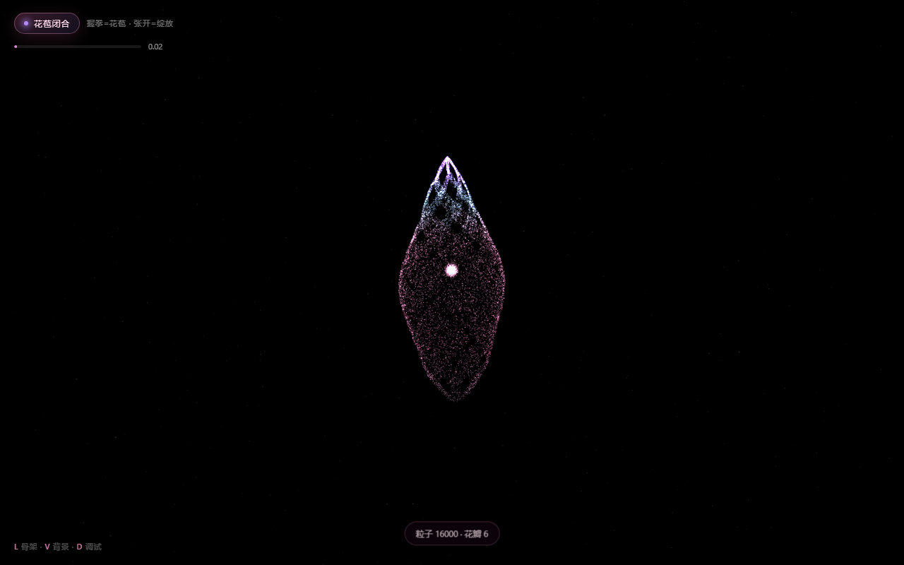
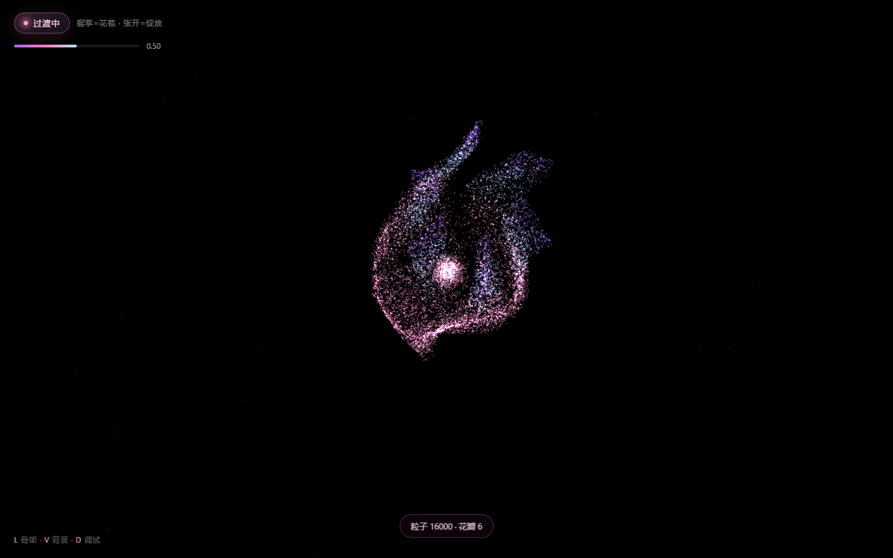
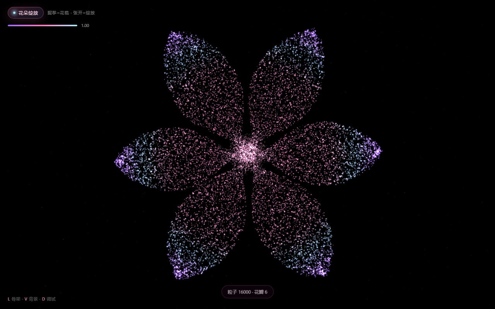

# 指尖生花 · Gesture Bloom

用摄像头识别手势，让一朵**发光粒子花**在你指尖绽放。

握拳 → 花朵收拢成花苞；张开手掌 → 粒子向外绽放；手的位置会带动花朵轻微跟随。
纯 Three.js + MediaPipe Hands + GLSL，无构建步骤，本地起个 HTTP 服务就能跑。

<p align="center">
  
  
  
</p>
<p align="center"><sub>花苞 · 半开 · 绽放</sub></p>

## 快速开始

摄像头 API 只在 **https** 或 **localhost** 下可用，所以不能直接双击 `index.html`。

```bash
# 方式一：Windows 双击 serve.cmd（自动找 node / python）
# 方式二：手动
node serve.mjs . 8787
# 方式三：只有 Python
python -m http.server 8787 --bind 127.0.0.1
```

然后打开 <http://localhost:8787/>，浏览器会请求摄像头权限，允许即可。

> 依赖已全部本地化到 `vendor/`（three 0.186、@mediapipe/hands 0.4），
> 不依赖 CDN，国内网络也能离线跑。约 13MB。

## 手势与 tension

`tension` 是手掌张开度，范围 `0 ~ 1`：**0 = 握拳，1 = 完全张开**。

计算方式（`src/hands.js` → `computeTension`）：

```
palmSpan   = |wrist(0) − middle_MCP(9)|            // 手掌尺度，用于归一化，抵消远近
ratio_i    = |wrist(0) − tip_i| / palmSpan         // 四指：tip ∈ {8,12,16,20}
meanRatio  = mean(ratio_i)                         // 握拳≈1.2~1.5，张开≈2.2~2.6
raw        = clamp((meanRatio − 1.12) / (2.30 − 1.12), 0, 1)
t          = smoothstep(raw)                        // 3t²−2t³，曲线更柔
```

再做一次**时间平滑**，避免临界抖动让花朵抽搐：

```js
tension += (target - tension) * 0.18
```

张开度映射到视觉（`src/main.js`）：

| tension | 状态 |
| --- | --- |
| `< 0.32` | 花苞闭合 |
| `0.32 ~ 0.66` | 平滑过渡（花瓣扭转外翻） |
| `> 0.66` | 完全绽放 |

绽放程度本身用需求指定的缓动：

```js
spread += (targetSpread - spread) * 0.1
```

## URL 参数

| 参数 | 默认 | 说明 |
| --- | --- | --- |
| `count` | 16000 | 粒子数量，范围 5000~20000 |
| `petals` | 6 | 花瓣数量，3~12 |
| `radius` | 1.95 | 花朵半径 |
| `seed` | 20261023 | 随机种子，同种子生成同一朵花 |
| `spread` | — | 固定绽放程度（`0`~`1`），用于截图/调参 |
| `camera` | — | `off` 关闭摄像头，进入鼠标模式 |
| `debug` | — | `1` 显示 fps / spread / 手部状态 |

例：`http://localhost:8787/?count=20000&petals=8&spread=0.8`

## 快捷键

| 键 | 作用 |
| --- | --- |
| `L` | 显示 / 隐藏 21 点手部骨架 |
| `V` | 摄像头在小窗 与 低透明度全屏背景 之间切换 |
| `D` | 调试信息 |
| `R` | 重连摄像头 |

## 实现要点

**花瓣形状**（`src/flower.js`）用显式参数化，而不是"半径阈值"：

```
u ∈ [0,1]   沿花瓣，0 = 花心，1 = 尖端
v ∈ [-1,1]  横向，±1 是花瓣边缘
halfW(u) = 0.52 · sin(π·u^0.75)^0.70 · (1 − 0.16u)
θ = p·2π/P + tilt[p] + v · halfW(u)
r = R · len[p] · (0.10 + 0.90u)
```

每片花瓣的长度/角度都有 ±6% 抖动，避免"完美对称的假花"。

**花苞**用同一套 `θ / u` 参数，只是收进一个竖立的水滴轮廓（上下收敛、中段最宽）
并按高度绕垂直轴扭转——所以中间态看到的是**花瓣向外翻开**，而不是一团球膨大。

**位置插值全部在顶点着色器**（`src/shaders.js`）完成：CPU 每帧只更新
`uSpread / uTime / uHand` 三个 uniform，16k 粒子也不会有 JS 开销。

**错峰绽放**：每颗粒子按 `aRho`、`aSeed` 分配一点点延迟，花心先开、瓣尖后开，
中间态才不是一团模糊。**叠加混合**（additive）容易过曝，所以单颗粒子压得很暗、
靠数量堆出光感，并且花苞态整体压暗、绽放态提亮，保证两种状态的亮度都稳定。

**配色**（顶点着色器 `palette()`，按 `aRho` 分层）：

| 区域 | 颜色 | 占比 |
| --- | --- | --- |
| 花心 | `#FF9ECF` + `#A7E8FF` | 点缀 |
| 花瓣主体 | `#FF7AB6` → `#FF9ECF` | ~60% |
| 花瓣外缘 | `#8FD3FF` → `#B388FF` | ~25% |
| 最外一圈 | `#9B6BFF` | ~15% |

不用深蓝、荧光绿、暖黄，底色纯黑。

## 目录结构

```
gesture-flower/
├─ index.html            页面骨架 + importmap
├─ serve.cmd             Windows 一键起服务
├─ serve.mjs             零依赖静态服务器（正确 MIME，含 .wasm/.data）
├─ src/
│  ├─ main.js            场景、动画循环、HUD、骨架绘制、兜底交互
│  ├─ flower.js          粒子几何：花瓣/花蕊/花苞/背景星尘
│  ├─ hands.js           MediaPipe 封装 + tension 计算
│  ├─ shaders.js         顶点/片元着色器（GLSL）
│  └─ style.css          HUD 与响应式
├─ vendor/
│  ├─ three/             three.module.js + three.core.js
│  └─ mediapipe/         hands.js + wasm/data（SIMD 版）
└─ docs/                 截图
```

## 兼容性与限制

- Chrome / Edge / Safari 16.4+ / Firefox 均可用；需要 WebGL 与 `getUserMedia`。
- 移动端浏览器要求 **https**（`localhost` 除外），并且只有前/后摄像头之一会被打开。
- 摄像头不可用时（拒绝授权、没有设备、被占用）会自动切到**鼠标模式**：
  左右移动鼠标即可控制绽放，页面仍可演示。
- 只为 1 只手做识别（`maxNumHands: 1`），多人场景取画面里最靠前的一只。
- MediaPipe 的手部模型在弱光/快速移动时会丢点，已用 400ms 宽限 + 时间平滑吸收。

## 许可与致谢

MIT（见 `LICENSE`）。第三方：
[three.js](https://github.com/mrdoob/three.js)（MIT）、
[MediaPipe Hands](https://github.com/google/mediapipe)（Apache-2.0）。
`vendor/` 下为两者的原样分发，遵循各自许可。

## 任何设备、任何人点开就能玩

页面不强制摄像头，进来先是可以直接玩的开始界面：

- **开启摄像头 · 用手势玩** → 点了才申请权限（iOS Safari 要求在用户手势里调用，
  所以不能自动弹权限框）。拿到画面后：握拳=花苞，张开=绽放。
- **不开启摄像头 · 触屏 / 鼠标玩** → 立刻可玩，不需要任何权限：
  - 手机：**按住屏幕** = 绽放，**松开** = 收拢；按住拖动花朵会跟着手指走。
  - 桌面：不按键左右移动鼠标也能控制；按住则全开。
- 摄像头失败（拒绝授权 / 没有设备 / 被占用 / 非 https）会弹提示，并**自动落到触屏模式**，
  不会卡在空白页。

线上地址走 GitHub Pages，是 https，所以手机上摄像头也能直接用：
<https://rafayellllllllllllll.github.io/gesture-flower/>

性能：手机自动降到 10000 粒子并把渲染分辨率限制在 1.6× DPR，保证 60fps 手感。
